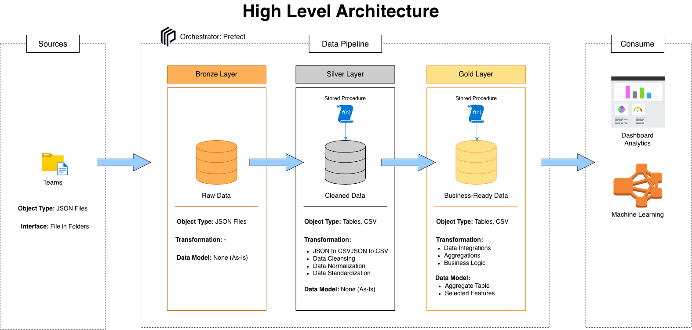
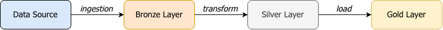
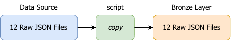
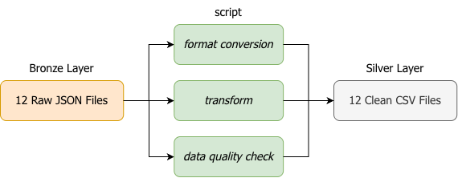
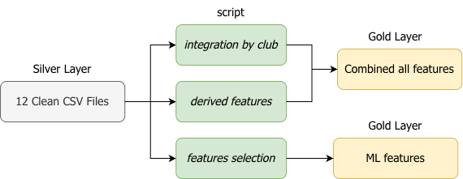
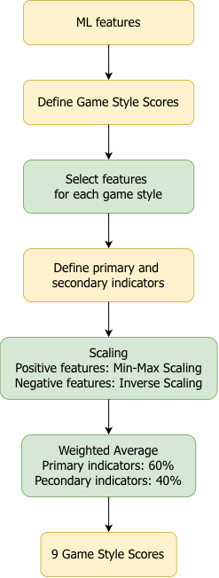
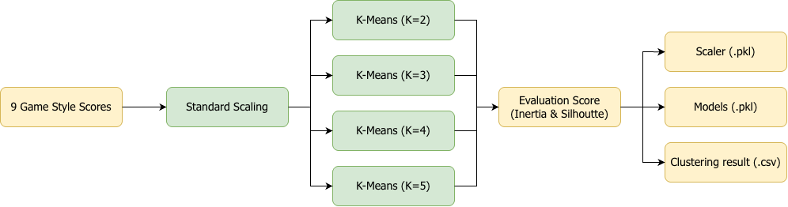

# ⚽ LaLiga Playing Style Analysis

**Data Pipeline, K-Means Clustering & Interactive Dashboard**

A data engineering and machine learning project that builds an end-to-end pipeline to analyze and cluster the playing styles of 20 La Liga clubs (2025-2026 season) using the Medallion Architecture, Prefect orchestration, and an interactive Streamlit dashboard.



---

## Table of Contents

- [Overview](#overview)
- [Architecture](#architecture)
- [Project Structure](#project-structure)
- [Tech Stack](#tech-stack)
- [Getting Started](#getting-started)
  - [Prerequisites](#prerequisites)
  - [Installation](#installation)
  - [Database Setup](#database-setup)
  - [Running the Pipeline](#running-the-pipeline)
  - [Launching the Dashboard](#launching-the-dashboard)
- [Data Pipeline](#data-pipeline)
  - [Bronze Layer](#bronze-layer)
  - [Silver Layer](#silver-layer)
  - [Gold Layer](#gold-layer)
- [Machine Learning](#machine-learning)
  - [Feature Engineering — Style Scoring](#feature-engineering--style-scoring)
  - [K-Means Clustering](#k-means-clustering)
- [Orchestration with Prefect](#orchestration-with-prefect)
- [Dashboard](#dashboard)
- [Dataset](#dataset)
- [License](#license)

---

## Overview

This project addresses the challenge of objectively classifying football playing styles. Traditional analysis relies on subjective observations. This project replaces that with a **quantitative, data-driven approach**:

1. **Data Pipeline** — Ingest, clean, validate, and integrate 12 JSON source files into a single One Big Table (OBT) using the Medallion Architecture (Bronze → Silver → Gold).
2. **Feature Engineering** — Transform 52 raw statistics into 9 interpretable Style Scores using domain-weighted normalization (60% primary / 40% supporting indicators).
3. **K-Means Clustering** — Group the 20 clubs into clusters based on their style score profiles, with support for multiple K values (K=2, 3, 4, 5).
4. **Interactive Dashboard** — Explore cluster assignments, compare team profiles, and visualize playing styles through radar charts, PCA scatter plots, and heatmaps.

---

## Architecture

The project follows the **Medallion Architecture** pattern for data processing:



```
datasets/JSON (Source)
    │
    ▼
┌──────────────────────────────────────┐
│  Bronze Layer — Raw Copy             │
│  12 JSON files copied as-is         │
└──────────────────────────────────────┘
    │
    ▼
┌──────────────────────────────────────┐
│  Silver Layer — Clean & Validate     │
│  JSON → CSV raw → CSV clean          │
│  DQ Validation (11 checks)           │
│  Load to PostgreSQL (silver schema)  │
└──────────────────────────────────────┘
    │
    ▼
┌──────────────────────────────────────┐
│  Gold Layer — Integrate & Enrich     │
│  12 tables → One Big Table (OBT)     │
│  Derived metrics & ML features       │
│  Export to CSV                        │
└──────────────────────────────────────┘
    │
    ▼
┌──────────────────────────────────────┐
│  ML — Style Scoring & Clustering     │
│  52 stats → 9 Style Scores           │
│  K-Means (K=2,3,4,5)                │
└──────────────────────────────────────┘
    │
    ▼
┌──────────────────────────────────────┐
│  Dashboard — Streamlit               │
│  Radar charts, PCA, Heatmaps         │
│  Interactive cluster exploration     │
└──────────────────────────────────────┘
```

---

## Project Structure

```
laliga-project/
│
├── config/
│   └── config.py                  # Centralized configuration (paths, DB, file lists)
│
├── datasets/                      # Source data (JSON)
│   ├── teams/                     # 12 JSON files (attacking, defending, passing, etc.)
│   └── players/                   # Player statistics (JSON)
│
├── data/                          # Pipeline output (generated)
│   ├── bronze/teams/              # Raw copies of source JSON
│   ├── silver/teams/
│   │   ├── csv_raw/               # JSON → CSV (no transformation)
│   │   └── csv_clean/             # Cleaned + validated CSV
│   ├── gold/teams/
│   │   ├── teams_statistics.csv   # One Big Table (OBT)
│   │   ├── teams_ml_features.csv  # ML-ready features
│   │   ├── teams_style_scores.csv # 9 computed style scores
│   │   └── teams_clustered.csv    # Cluster assignments
│   ├── clustering_results/        # Per-K cluster results (k2–k5)
│   └── models/                    # Trained model artifacts
│       ├── scaler.pkl             # StandardScaler
│       └── kmeans_k{2,3,4,5}.pkl  # KMeans models
│
├── src/
│   ├── bronze/
│   │   └── ingestion_teams.py     # Bronze ingestion logic
│   ├── silver/
│   │   └── transform_teams.py     # Silver transform + DQ validation
│   ├── db/
│   │   ├── load_silver.py         # Load to PostgreSQL silver schema
│   │   └── load_gold.py           # Load to PostgreSQL gold schema + CSV export
│   ├── sql/
│   │   ├── ddl_teams.sql          # Silver table DDL
│   │   ├── ddl_gold_teams.sql     # Gold table DDL (OBT + ML features)
│   │   ├── proc_load_teams.sql    # Silver load procedure
│   │   └── proc_load_gold_teams.sql  # Gold load procedure
│   └── utils/
│       ├── helpers.py             # Reusable functions (ingest, transform, DB ops)
│       └── validators.py          # Data quality validation checks
│
├── assets/                        # Documentation images & diagrams
│
├── main.py                        # Pipeline entry point (plain Python)
├── main_prefect.py                # Pipeline entry point (Prefect orchestrated)
├── streamlit_app.py               # Interactive dashboard
├── requirements.txt               # Python dependencies
└── .env                           # Database credentials (not tracked in git)
```

---

## Tech Stack

| Component | Technology | Purpose |
|-----------|-----------|---------|
| Language | Python 3.11 | All components |
| Database | PostgreSQL | Silver & Gold layer storage |
| Data Manipulation | pandas, numpy | Data transformation & cleaning |
| DB Connector | psycopg2, SQLAlchemy | PostgreSQL connection & operations |
| Machine Learning | scikit-learn | StandardScaler, KMeans, PCA, Silhouette Score |
| Model Serialization | joblib | Save/load `.pkl` model artifacts |
| Orchestration | Prefect 3.x | Pipeline orchestration, retries, logging |
| Dashboard | Streamlit | Interactive web interface |
| Visualization | Plotly | Interactive charts (radar, scatter, heatmap) |
| Environment | python-dotenv | Database credential management |

---

## Getting Started

### Prerequisites

- Python 3.11+
- PostgreSQL (running locally or remotely)

### Installation

```bash
# Clone the repository
git clone https://github.com/<your-username>/laliga-project.git
cd laliga-project

# Install dependencies
pip install -r requirements.txt
```

### Database Setup

Create a `.env` file in the project root:

```env
DB_HOST=localhost
DB_PORT=5432
DB_NAME=laliga
DB_USER=your_username
DB_PASSWORD=your_password
```

Ensure the PostgreSQL database exists:

```bash
createdb laliga
```

The pipeline will automatically create the required schemas (`silver`, `gold`), tables, and stored procedures.

### Running the Pipeline

**Option 1 — Plain Python (without orchestrator):**

```bash
python main.py
```

**Option 2 — With Prefect orchestration (recommended):**

```bash
python main_prefect.py
```

Both options execute the same 4-step pipeline:

| Step | Description | Input | Output |
|:----:|-------------|-------|--------|
| 1 | Bronze Ingestion | `datasets/teams/*.json` | `data/bronze/teams/*.json` |
| 2 | Silver Transform | Bronze JSON | `data/silver/teams/csv_clean/*.csv` |
| 3 | Load Silver to DB | Clean CSVs | PostgreSQL `silver` schema |
| 4 | Load Gold to DB | Silver tables | PostgreSQL `gold` schema + `data/gold/teams/*.csv` |

### Launching the Dashboard

```bash
streamlit run streamlit_app.py
```

The dashboard will open at `http://localhost:8501`.

---

## Data Pipeline

### Bronze Layer



The Bronze layer performs a raw, as-is copy of the 12 source JSON files from `datasets/teams/` to `data/bronze/teams/`. No transformations are applied — this layer serves as an immutable landing zone for auditability and reprocessing.

**Source files (12 JSON):**

| Category | Files |
|----------|-------|
| Attacking | `teams_attacking_overall`, `teams_attacking_non_penalty`, `teams_attacking_set_pieces`, `teams_attacking_misc` |
| Defending | `teams_defending_defensive_action`, `teams_defending_overall`, `teams_defending_set_piece`, `teams_defending_misc` |
| Other | `teams_passing`, `teams_pressing`, `teams_sequences`, `teams_misc` |

### Silver Layer



The Silver layer transforms raw data into clean, validated, analysis-ready datasets through 3 sub-steps:

1. **JSON → CSV Raw** — Convert Bronze JSON to CSV format without modification.
2. **CSV Raw → CSV Clean** — Apply table-specific cleaning functions (e.g., convert `"13.73%"` string to `13.73` float).
3. **DQ Validation** — Run 11 data quality checks per table (column count, null check, data types, row count = 20, etc.).
4. **Load to PostgreSQL** — Execute DDL + stored procedures to load clean CSVs into the `silver` schema.

### Gold Layer



The Gold layer integrates 12 Silver tables into two analysis-ready tables:

| Table | Description | Columns |
|-------|-------------|:-------:|
| `gold.teams_statistics` | One Big Table — all team statistics joined by `club` | 124 |
| `gold.teams_ml_features` | Subset of columns selected for ML feature engineering | 61 |

Both tables are exported to CSV at `data/gold/teams/` for use by downstream ML and dashboard components.

---

## Machine Learning

### Feature Engineering — Style Scoring



52 raw statistics are transformed into **9 interpretable Style Scores** (scale 0–100) that represent distinct dimensions of a team's playing style:

| # | Style Score | What It Measures |
|:-:|------------|-----------------|
| 1 | Possession Score | Ball retention and control |
| 2 | Build-up Score | Patient, progressive build-up play |
| 3 | Pressing Score | High pressing intensity and effectiveness |
| 4 | Attacking Threat Score | Shot creation and goal conversion |
| 5 | Set-Piece Threat Score | Dead-ball effectiveness (attacking) |
| 6 | Defensive Solidity Score | Defensive actions and resistance |
| 7 | Direct Play Score | Fast, vertical attacking sequences |
| 8 | Crossing Score | Wide play and crossing effectiveness |
| 9 | Aerial Threat Score | Aerial duel dominance |

**Scoring methodology:**
1. **Min-Max Normalization** — Each indicator is scaled to 0–100 (with inverse scaling for metrics where lower is better, e.g., goals conceded).
2. **Weighted Average** — Indicators within each style dimension are classified as Primary (60% weight) or Supporting (40% weight).

### K-Means Clustering



The 9 style scores are used as input features for K-Means Clustering:

1. **Preprocessing** — `StandardScaler` normalizes the 9 style scores to zero mean and unit variance.
2. **Training** — K-Means models are trained for K = 2, 3, 4, and 5.
3. **Evaluation** — Models are compared using:
   - **Inertia** (Elbow Method) — measures within-cluster sum of squares.
   - **Silhouette Score** — measures cluster separation quality (-1 to +1).
4. **Persistence** — All models (`kmeans_k{K}.pkl`) and the scaler (`scaler.pkl`) are saved for the dashboard.

---

## Orchestration with Prefect

The pipeline can be orchestrated using **Prefect 3.x** via `main_prefect.py`. Prefect adds observability, automatic retries, structured logging, and deployment capabilities without modifying the existing business logic.

**Features used:**

| Feature | Usage |
|---------|-------|
| `@task` | 4 tasks: `bronze-ingestion`, `silver-transform`, `load-silver-to-db`, `load-gold-to-db` |
| `@flow` | 4 flows: `bronze-pipeline`, `silver-pipeline`, `gold-pipeline`, `laliga-master-pipeline` |
| Tags | Per-layer grouping: `bronze`, `silver`, `gold`, `database`, `transform`, `ingestion` |
| Retries | `retries=2, retry_delay_seconds=10` for database tasks |
| Logging | `get_run_logger()` — structured logging integrated with Prefect UI |
| Runtime Context | `flow_run.get_id()`, `flow_run.get_name()` for run traceability |
| States | Automatic exception propagation for sub-flow failure handling |
| Deployment | `.serve()` for scheduled pipeline execution |

For full documentation, see [`assets/prefect-orchestration.md`](assets/prefect-orchestration.md).

---

## Dashboard

The Streamlit dashboard provides three interactive views for exploring the analysis results:

### 1. Cluster Analysis
- Cluster membership table with team assignments
- PCA 2D scatter plot with cluster coloring
- Cluster centroid comparison via radar chart
- Dynamic K selection (K=2, 3, 4, 5) from the sidebar

### 2. Team Playing Style
- Individual team radar chart showing 9 style scores
- Style score ranking across all 20 clubs
- Expandable detailed statistics grouped by category
- Style score correlation heatmap

### 3. Playing Style Comparison
- Side-by-side radar chart comparison (2–4 teams)
- Tabular score comparison with difference highlighting
- Cluster-level aggregated comparison

**Launch:**
```bash
streamlit run streamlit_app.py
```

---

## Dataset

- **Source**: La Liga 2025-2026 season team statistics
- **20 clubs**, **12 statistical categories**, **52 metrics** per team
- **Categories**: Attacking (overall, non-penalty, set pieces, misc), Defending (defensive action, overall, set pieces, misc), Passing, Pressing, Sequences, Miscellaneous

---

## License

This project was built as part of a Thesis (Tugas Akhir) at Institut Teknologi Bandung.
